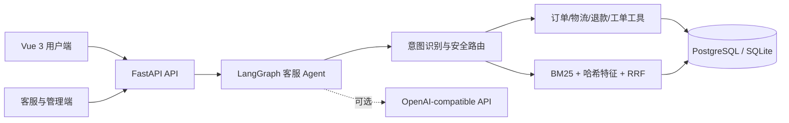

# EnterpriseMind 企业智能客服与业务 Agent 系统

> 面向电商售后与企业服务场景的全栈智能客服系统：让 Agent 不只回答问题，还能安全地查询业务数据、执行退款流程、检索企业知识，并在必要时转交人工客服。

EnterpriseMind 是一个可独立运行的企业客服 Agent 项目。系统以 LangGraph 编排对话状态和业务任务，通过受权限约束的工具访问订单、物流、商品、退款与工单数据；知识问答使用可解释的混合检索，并提供人工接管、运行轨迹和自动评测能力。

项目不依赖大模型也能完成核心业务演示。配置兼容 OpenAI Chat Completions 的模型服务后，大模型只负责自然语言理解与答案组织，权限校验、业务规则和数据读写仍由后端确定性代码控制。

## 核心亮点

- **可执行的 Agent 工作流**：使用 LangGraph 实现意图识别、安全检查、任务路由、工具调用、知识检索与答案生成，不是单纯的聊天接口封装。
- **完整售后业务闭环**：支持订单与物流查询、多轮退款确认、防重复提交、售后工单，以及机器人与人工客服之间的双向交接。
- **可解释的企业 RAG**：解析 PDF、DOCX、XLSX、CSV、TXT 和 Markdown 文档，通过 BM25、确定性哈希特征与 RRF 完成双路召回和融合排序，并返回引用与阶段分数。
- **权限和数据安全**：提供 customer、service、admin 三级角色；业务工具从 JWT 身份获取用户信息，订单与工单查询强制校验数据所有权。
- **可观测与可评估**：记录 Agent 意图、工具轨迹、知识引用、延迟、Token 和成本，并用固定回归集实际运行自动评测。
- **完整工程链路**：FastAPI 与 Vue 3 前后端分离，支持 SQLite 开箱体验、PostgreSQL 生产部署、Alembic 迁移、Docker Compose 和 GitHub Actions 质量门禁。

## 技术栈

| 层级 | 技术 |
| --- | --- |
| Agent 与模型 | LangGraph、OpenAI-compatible Chat Completions API |
| 后端 | FastAPI、Pydantic、SQLAlchemy、Alembic、PyJWT |
| 数据与检索 | PostgreSQL / SQLite、BM25、哈希特征、RRF |
| 前端 | Vue 3、TypeScript、Vite、Pinia、Element Plus |
| 工程化 | Pytest、Ruff、Docker Compose、Nginx、GitHub Actions |

## 核心业务闭环

1. **智能问答**：用户消息 → 意图与安全检查 → 业务工具或知识库 → 带引用和工具轨迹的回复。
2. **多轮退款**：收集订单号 → 校验订单归属与退款资格 → 收集退款原因 → 用户二次确认 → 防重复校验 → 创建退款记录与售后工单。
3. **人工接管**：用户申请转人工 → 会话进入排队 → 客服独占接管并双向回复 → 处理完成后交回机器人。
4. **自动评测**：运行固定业务与知识问答用例 → 校验答案事实、引用和工具状态 → 汇总延迟、Token、成本与满意度。

| 角色 | 主要能力 |
| --- | --- |
| 普通用户 | 智能聊天、订单物流查询、退款申请、查看工单、转人工 |
| 客服人员 | 人工接管、用户回复、工单处理、评测结果查看 |
| 管理员 | 客服能力、知识库管理、模型配置、运营数据与系统评测 |

## 系统架构



业务工具、RAG 检索和安全路由都可在没有大模型 API 时运行；配置 API 后，仅把大模型用于自然语言理解与答案组织。

### 关键设计决策

- **模型不直接操作数据库**：LLM 只能选择受控工具；工具参数、当前用户和数据权限由 FastAPI 服务端重新校验。
- **多轮流程显式建模**：退款所需字段、确认状态和处理结果保存在会话状态中，避免仅依赖提示词记忆关键业务步骤。
- **失败保持数据一致性**：Agent 执行异常时回滚本轮尚未完成的消息与运行记录，避免留下半完成会话。
- **检索结果可解释**：保留 BM25、哈希特征与 RRF 分数及原文引用，便于排查召回问题和复核答案依据。
- **外部模型可降级**：未配置或无法访问 LLM 时，订单、物流、退款、知识检索等核心演示仍可使用确定性逻辑运行。

## 本地启动

推荐使用 Python 3.12 与 Node.js 22；前端最低要求为 Node.js 20.19。

如果已经创建 Conda 环境 `ai` 并安装好依赖，Windows 下直接双击项目根目录的 `一键启动.cmd`。脚本会自动检查环境、执行数据库迁移、启动前后端并打开浏览器；保持启动窗口开启，按 `Ctrl+C` 即可停止全部服务。

也可以在 PowerShell 中启动：

```powershell
.\一键启动.cmd
```

以下是手动启动方式：

```bash
python -m venv .venv
# Windows
.venv\Scripts\pip install -r backend\requirements.txt
.venv\Scripts\python backend\run.py
```

另开一个终端：

```bash
cd frontend
npm install
npm run dev
```

访问 `http://localhost:5173`，后端 Swagger 文档位于 `http://localhost:8000/docs`。

> 注意：`8000/docs` 和 `8000/health` 是后端接口与健康检查页面；用户实际操作界面是 `http://localhost:5173`，需要单独启动 `frontend`。

演示账号：

| 角色 | 用户名 | 密码 |
| --- | --- | --- |
| 普通用户 | `customer` | `Customer123!` |
| 客服人员 | `service` | `Service123!` |
| 管理员 | `admin` | `Admin123!` |

可直接在聊天中测试：

- `查询订单 EM20260710001`
- `这个订单物流到哪了？`（需要带上订单号时 Agent 会追问）
- `七天无理由退货有什么要求？`
- `云声 Air 2 耳机适合什么场景？`
- `客服遇到投诉和律师相关表述时应该怎么处理？`
- `我要退货`（进入多轮退款流程）
- `转人工客服`

客服或管理员登录后，可进入“人工接管”工作台接管该会话、直接回复用户，并在处理完成后交回智能客服。用户聊天页每 4 秒同步一次人工回复，无需刷新页面。

## Docker 一键启动

先复制 Docker 环境模板，并把其中两个 `replace_with_...` 值替换为随机强密码：

```powershell
Copy-Item .env.docker.example .env
notepad .env
docker compose config --quiet
docker compose up --build
```

访问 `http://localhost:8080`。容器启动时会先执行 `alembic upgrade head`；生产环境会拒绝默认 JWT 密钥和演示种子账号。

首次生产部署后，通过交互式命令创建管理员，密码不会出现在命令历史中：

```powershell
docker compose exec backend python -m app.cli create-admin --username admin --email admin@example.com
```

## 数据库迁移

通过 `backend/run.py` 启动本地服务时，会自动把数据库升级到最新 Alembic 版本。也可以手动执行：

```powershell
Set-Location backend
alembic -c alembic.ini upgrade head
alembic -c alembic.ini check
```

从早期未使用 Alembic 的本地 SQLite 数据库升级时，先执行一次：

```powershell
alembic -c alembic.ini stamp 20260710_0001
alembic -c alembic.ini upgrade head
```

## 配置大模型

复制 `.env.example` 为 `.env`，填写任意兼容 OpenAI Chat Completions 的服务：

```env
LLM_BASE_URL=https://your-provider.example/v1
LLM_API_KEY=your-key
LLM_MODEL=your-model
```

## 轻量可解释 RAG（无需下载模型）

知识库检索链路已经升级为：

```text
文档解析与切块
  → BM25 关键词召回
  → SHA-256 确定性哈希特征召回
  → RRF 融合两路排名
  → 返回 Top K 文档片段、引用和各阶段分数
```

该实现不依赖 Hugging Face、本地 Embedding、Reranker、pgvector 或 GPU，不会在首次运行时下载模型。哈希特征是轻量词法特征，不冒充语义 Embedding；项目通过检索轨迹明确展示 `bm25_score`、`hashed_vector_score` 和 `rrf_score`。这让演示环境稳定、实现边界诚实，也便于面试时解释召回与融合过程。

唯一的检索配置：

```env
RAG_CANDIDATE_LIMIT=50
```

完整的检索、存储、降级与测试设计见 [`docs/RAG_ARCHITECTURE.md`](docs/RAG_ARCHITECTURE.md)。

## 自动评估中心

客服或管理员可以进入“评估中心”，点击“运行自动评测”。系统会实际执行订单、物流、商品和知识问答等 6 个无副作用回归用例，并保存每次运行的历史结果：

- 回答正确率：预期关键事实在答案中的覆盖比例；
- 引用来源准确率：RAG 用例是否命中预先标注的知识文档；
- 工具调用成功率：预期业务工具是否以成功状态完成；
- 平均响应时间：完整 LangGraph Agent 调用的端到端耗时；
- Token 与成本：读取兼容 OpenAI 接口返回的 `usage`，优先采用供应商返回的 cost；
- 用户满意度：聊天消息点赞数除以全部有效点赞与点踩数。

供应商未返回 cost 时，可在 `.env` 中配置每百万 Token 单价：

```env
LLM_INPUT_COST_PER_MILLION=0
LLM_OUTPUT_COST_PER_MILLION=0
```

免费模型保持为 0 即可。完整指标口径与回归集见 [`docs/EVALUATION.md`](docs/EVALUATION.md)。

## 项目结构

```text
backend/app/
├── agents/       # LangGraph 客服状态机
├── api/          # 认证、业务、聊天、知识库、管理 API
├── core/         # 配置、数据库、JWT 与密码安全
├── rag/          # 文档解析、切块与混合检索
├── services/     # 业务工具与可选 LLM 客户端
├── models.py     # SQLAlchemy 业务数据模型
└── seed.py       # 演示用户、订单、物流与知识库

frontend/src/
├── api/          # Axios 客户端
├── layouts/      # 角色导航与应用框架
├── router/       # 登录和角色路由守卫
├── stores/       # Pinia 身份状态
└── views/        # 登录、聊天、订单、工单、管理页
```

## 测试与质量门禁

安装后端开发依赖：

```bash
cd backend
python -m pip install -r requirements-dev.txt
```

运行后端测试和静态检查：

```bash
pytest -q
ruff check app tests run.py migrations/env.py
```

默认测试覆盖健康检查、角色权限、订单所有权、Agent 工具路由、退款二次确认、防重复退款、BM25/哈希特征双路召回、RRF、RAG 引用、文档上传、事务回滚、级联删除、时区和生产配置防护。配置 `TEST_POSTGRES_URL` 后，还会执行 Alembic 与 PostgreSQL 外键级联集成测试；为避免误操作，该数据库名称必须以 `_test` 结尾。

前端质量门禁：

```powershell
Set-Location frontend
npm ci
npm run build
```

GitHub Actions 会依次执行后端测试、真实 PostgreSQL 集成测试、前端构建，以及 Docker Compose 构建和健康检查。

本次本地验证结果（2026-09-05）：

| 检查项 | 结果 |
| --- | --- |
| Pytest（SQLite，排除 `tests/test_postgres.py`） | 45 passed，包含新增的 15 项业务回归用例 |
| Ruff 静态检查 | 本次未运行，当前虚拟环境未安装 Ruff |
| Vue TypeScript 类型检查 | 通过 |
| Vite 生产构建 | 通过 |

> 当前虚拟环境缺少 Alembic，本次显式排除了 PostgreSQL 测试模块，不代表 PostgreSQL 或迁移验证通过。安装完整测试依赖后，未配置 `TEST_POSTGRES_URL` 的条件用例会跳过；CI 已配置 `postgres:16-alpine` 服务，本次未验证远端执行结果。

新增回归覆盖否定句、疑问句、引用及含糊回复不触发退款写入，明确确认可以提交，重复转人工可以由其他客服接管，以及维修工单进入 `waiting_customer` 状态。退款最终确认仅接受独立回复“确认提交”（可带句号或感叹号），不把单独的“同意”“提交”等词视为授权。

## 安全设计

- 业务工具从 JWT 当前用户获取 `user_id`，不信任模型或前端传入的用户标识。
- 普通用户查询订单、工单时始终附加所有权条件。
- Agent 在路由前拦截常见 Prompt 注入与危险 SQL 指令。
- 文件名使用 `Path.name` 清理并限制扩展名，上传文件存储到知识库隔离目录。
- 上传大小默认限制为 20 MB，可通过 `MAX_UPLOAD_MB` 调整。
- 生产环境禁止 `AUTO_SEED`，并对默认或过短的 `JWT_SECRET` 执行启动失败保护。
- PBKDF2 密码散列使用随机盐；生产环境应把密钥放入密钥管理服务并增加令牌吊销机制。

## 能力边界与后续方向

当前版本定位为可运行、可测试、可解释的企业客服 MVP，而不是已经完成多租户和高并发验证的生产 SaaS：

- 哈希特征提供第二路轻量词法信号，但不等同于语义 Embedding；知识规模扩大后可替换为独立向量服务并增加 Reranker。
- 人工客服回复目前采用前端定时同步，后续可升级为 WebSocket 或 SSE，降低消息到达延迟。
- 当前面向单企业演示数据，后续可加入租户隔离、细粒度权限策略、审计日志和 JWT 吊销机制。
- 固定回归集适合作为基础质量门禁，后续可扩展为版本化评测数据集、人工标注流程和发布阈值阻断。
