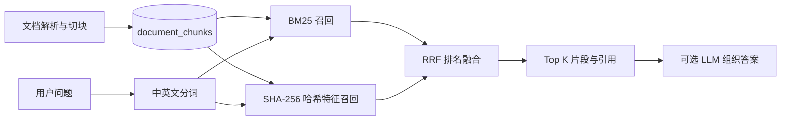

# EnterpriseMind 轻量 RAG 架构

## 设计目标

本项目优先保证可运行、可解释和零模型下载。检索层不依赖本地 Embedding、Cross-Encoder、GPU、pgvector 或外部网络；大模型 API 不可用时，知识库检索和引用仍然工作。

## 检索链路

1. BM25 负责精确关键词、订单政策术语和稀有词匹配。
2. 哈希特征把 token 稳定映射到 384 个桶，以余弦相似度提供第二路词法信号。
3. Reciprocal Rank Fusion（RRF）只融合排名，避免直接比较两种不同量纲的原始分数。
4. 每条结果保留 `bm25_score`、`hashed_vector_score`、`rrf_score` 和策略名称，便于调试。

## 能力边界

哈希特征不是语义 Embedding，不能理解完全不同措辞之间的深层语义关系。项目在代码和界面中如实称其为“哈希特征”，不把它包装成向量模型。对于当前演示知识库，BM25、哈希特征、RRF、引用和可选的大模型答案组织足以完整展示 RAG 工程链路。

未来语料规模和评估集证明有必要时，可以把第二路召回替换为托管 Embedding API 或独立向量服务；当前版本不为尚未发生的规模问题增加运行负担。

## 数据与部署

- 文档切块只保存文本和页码、章节、字符位置等元数据。
- SQLite 和标准 PostgreSQL 16 使用同一套检索逻辑。
- Docker 使用官方 `postgres:16-alpine`，不需要额外数据库扩展。
- 唯一检索配置为 `RAG_CANDIDATE_LIMIT`，默认 50。

## 测试范围

- 哈希特征的确定性与余弦相似度；
- BM25 与哈希特征排名的 RRF 融合；
- 检索结果和调试分数；
- 文档上传、切块、搜索与删除；
- Agent 知识问答的引用来源；
- SQLite 默认测试与 PostgreSQL Alembic 集成测试。
